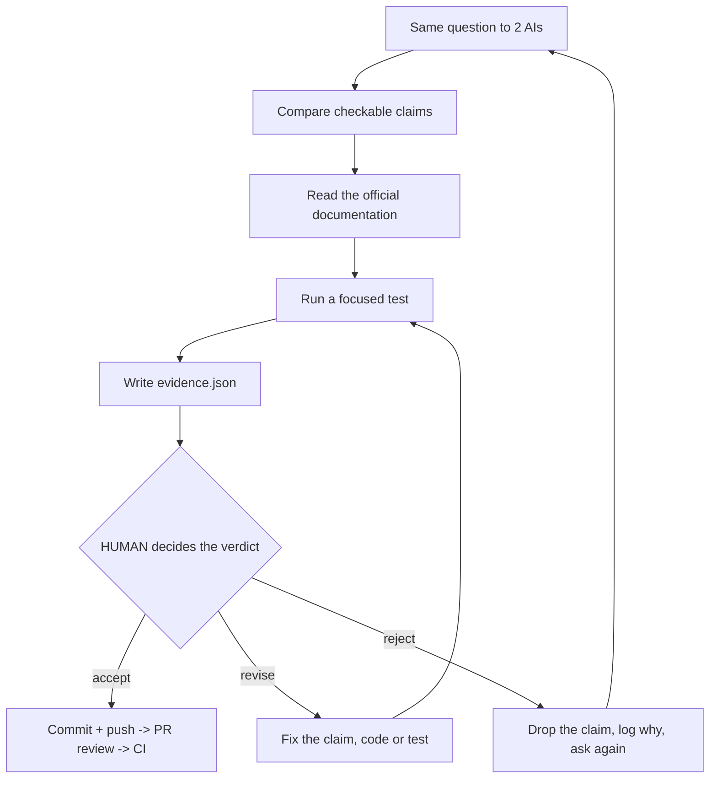

# Afternoon exercise: verifying one AI claim

| File | What it is |
| --- | --- |
| [question.md](question.md) | The question asked, word for word, to both AIs |
| [answer_A_sonnet.md](answer_A_sonnet.md), [answer_B_haiku.md](answer_B_haiku.md) | The two saved answers from separate conversations |
| [eof_dup_test.cpp](eof_dup_test.cpp) | The focused test (uses our `miniposix` library) |
| [evidence.json](evidence.json) | The evidence record: `claim`, `source_url`, `test_command`, `observed`, `verdict` |
| [workflow.py](workflow.py) | Script that checks the evidence and stops for the human decision |

**Important claim:** a pipe reader sees EOF only after *every* descriptor of the write end is closed, including `dup()`/`fork()` copies.

**Documentation:** <https://man7.org/linux/man-pages/man7/pipe.7.html>, section "I/O on pipes and FIFOs".

**Test result (Linux, clang 22):** with a `dup()` copy still open, `read()` returned `-1/EAGAIN` (no EOF). After closing the copy, `read()` returned `0` (EOF). Writing with no reader and SIGPIPE ignored gave `-1/EPIPE`. All checks passed.

`verdict` is left empty on purpose: **a team member must set it** to `accept`, `revise`, or `reject`.

## Workflow



Run the gate:

```bash
python3 verification/workflow.py verification/evidence.json
```
